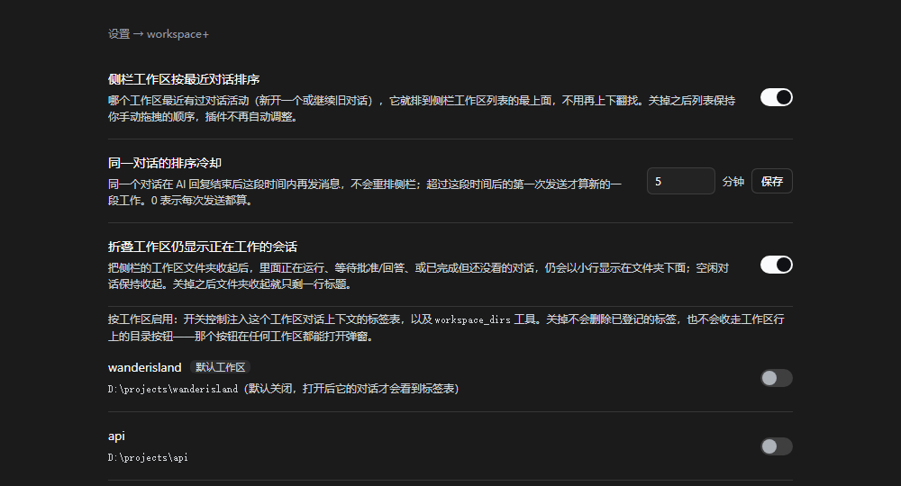

# dsh-workspace-plus

[](https://www.npmjs.com/package/dsh-workspace-plus)
[](https://dsh-plugin.org/plugins/sen70s/dsh-workspace-plus)
[](https://github.com/Sen70s/dsh-workspace-plus/blob/main/LICENSE)
**当前版本 `v0.7.1`** · 要求 DSH `>=0.1.7-rc.2`
DeepSeek Harness（DSH）的插件。一个插件，两个子功能，插件页里各占一行、可单独启停。

DeepSeek Harness（DSH）的插件。一个插件，三个子功能，插件页里各占一行、可单独启停。

| 子功能 | 说明 |
| --- | --- |
| **workspace+** | 一个工作区登记多个目录，每个目录一个标签。标签表注入每次请求，输入框打 `@` 也能直接引用 |
| **通知 / notice** | 对话请求权限、询问用户、任务完成、中断、出错时弹 Windows 原生通知，点通知直接回到那个对话 |

## 安装

```sh
dsh plugin --profile desktop add dsh-workspace-plus
```

装完**重启 `dsh`** 并刷新页面。

卸载：`dsh plugin --profile desktop remove dsh-workspace-plus`

> 自 0.6.0 起通知（notice）已并入本包。若你此前装过独立的 `dsh-notice` 插件，先从 profile 里移除它再装本包 —— 两者的路由、协议与设置存储完全相同，同装会同名冲突。

## workspace+：一个工作区，多个目录

一个工作区（DSH 里 = 一个目录）装不下真实项目。前后端分两个仓库、文档在第三个目录时，把这三个目录登记成标签，agent 就不再需要你每次手写绝对路径。

**1. 打开弹窗。** 鼠标停在侧边栏任意工作区那一行，操作区会多出一个文件夹图标，点它。


**2. 添加目录。** 点「添加目录」，用系统的目录选择器选一个目录；标签为空时会按目录名猜一个（`D:\proj\my api` → `my-api`），也可以自己写，再加一句说明。


**3. 之后就不管了。** 每次请求 agent 都能看到这张「标签 → 绝对路径」表：

```text
用户：把 backend 的登录接口改成 JWT
agent 直接去 D:\proj\backend，不会因为旁边有个 backend-legacy 而改错门。
```

在输入框打 `@` 会多出一组「工作区目录」候选，选中后落一个 chip —— **送给模型的是那个目录的绝对路径**，所以哪怕标签表被上下文压缩挤掉了，指代也不会失焦。

**4. 每个工作区一个开关。** 设置 → `workspace+`，一行一个开关（默认工作区默认关闭，其它默认开启）。关掉不删标签，只是这个工作区暂时不参与。



也可以直接在对话里让 agent 管：「把 `D:\proj\backend` 记成 backend，说明写后端 API」「现在有哪些标签？」「backend 改指向 `D:\proj\backend-v2`」「删掉 docs」。

> **建议把工作区建在几个项目的共同父目录上**，标签都放进去。DSH 的沙箱只认工作区根目录为可写根，根目录之外的目录只能读，agent 每次越界写入都要你批准一次。

## 通知：后台跑着，不用盯着窗口

装好即用。请求权限、询问用户、任务完成、中断、出错都会弹 toast，点一下就打开对应的对话。

正常情况下，点通知不会再先闪一个终端窗口。首次注册 `dsh-notice:` 协议时（插件加载后就会发生），宿主会用系统自带的 `csc.exe` 把一个小助手（约 10 KB 的 `click-host.exe`）编译到 `~/.dsh/notice/` 并缓存；之后点击由这个助手在无窗口的情况下完成，窗口被别的程序挡住、最小化甚至收进托盘，它都能恢复并切到前台（最大化状态保持不变）。编译不可用时自动退化为无窗口 PowerShell（改由 Harness 自己把窗口切到前台），再不行就退化为普通 PowerShell 兼容模式（可能有窗口闪烁）；当前用的是哪一种，设置 → 通知 的状态区会直接写明。

设置 → 通知 里可以选通知类型、声音、时长、注册协议、发一条测试通知。这里还有一个「启用桌面通知」开关，不动插件页也能静音。

设置存在 `~/.dsh/notice/`，协议 scheme 是 `dsh-notice:` —— 从独立 dsh-notice 插件升级过来时，已有设置与协议注册自动生效。

## 自检

不需要安装、不需要 DSH 在跑：

```sh
node tools/verify.mjs
```

521 项断言，覆盖 manifest、patch 层、宿主半（含 `/workspaceplus/api` 在认证服务缺失时的拒绝）、浏览器半、工作区行按钮、`@` 候选源、弹窗形状，以及通知点击启动器的编译与回退（含真实 `csc.exe` 编译一次并自检）。

## 其它

- `lib/` 是手写源码，**不需要打包步骤**（没有 bundler）：从 npm、GitHub、本地目录三种方式装到的都是可直接加载的代码。唯一的例外是通知点击助手 —— 它由宿主在首次注册协议跳转时（插件加载后就会发生）用系统自带的 `csc.exe` 从 `lib/notice/click-host.cs` 现编到 `~/.dsh/notice/` 并缓存；编译不可用时自动退化为 PowerShell 启动器，插件其余部分不受影响。
- workspace+ 的状态文件在 `~/.dsh/workspaceplus/directories.json`，可以直接手改，改完刷新页面即可。
- workspace+ 的浏览器接口 `/workspaceplus/api` 每次请求都要过宿主的 `connection.admit` 认证。认证服务缺失、`admit` 不存在或报错时一律 **503**，读写都不放行——这个接口写下的目录备注会进入模型上下文，不能让未认证的调用方有机会修改它。
- [LICENSE](./LICENSE) · MIT

## Star History

[](https://www.star-history.com/#Sen70s/dsh-workspace-plus&Date)
