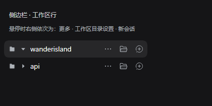
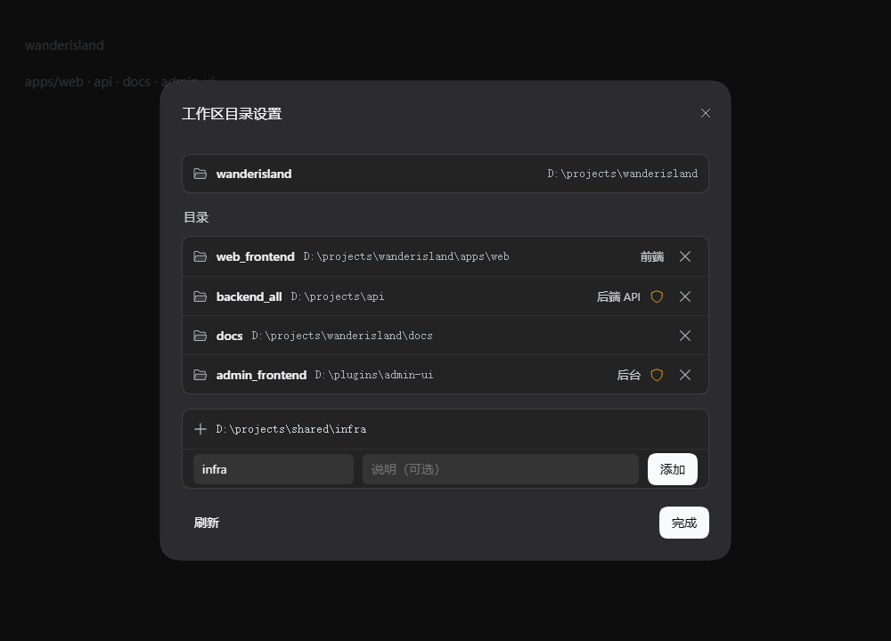
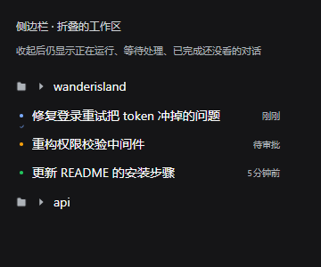

# dsh-workspace-plus

[](https://www.npmjs.com/package/dsh-workspace-plus)
[](https://dsh-plugin.org/plugins/sen70s/dsh-workspace-plus)
[](https://github.com/Sen70s/dsh-workspace-plus/blob/main/LICENSE)

**当前版本 `v0.9.0`** · 要求 DSH `>=0.1.7-rc.2`

DeepSeek Harness（DSH）的插件。一个插件，两个子功能，插件页里各占一行、可单独启停。

| 子功能 | 说明 |
| --- | --- |
| **workspace+** | 一个工作区登记多个目录，每个目录一个标签。标签表注入每次请求，输入框打 `@` 也能直接引用；删除工作区时还会先问一句要不要归档它的对话；侧栏工作区列表可按最近对话自动排序（插件详情页里可关） |
| **通知 / notice** | 对话请求权限、询问用户、任务完成、中断、出错时弹 Windows 原生通知，点通知直接回到那个对话 |

## 安装

```sh
dsh plugin --profile desktop add dsh-workspace-plus
```

装完**重启 `dsh`** 并刷新页面。

卸载：`dsh plugin --profile desktop remove dsh-workspace-plus`

> 自 0.6.0 起通知（notice）已并入本包。若你此前装过独立的 `dsh-notice` 插件，先从 profile 里移除它再装本包 —— 两者的路由、协议与设置存储完全相同，同装会同名冲突。

## workspace+：一个工作区，多个目录

一个工作区（DSH 里 = 一个目录）装不下真实项目。前后端分两个仓库、文档在第三个目录时，把这三个目录登记成标签，agent 就不再需要你每次手写绝对路径。

**1. 打开弹窗。** 鼠标停在侧边栏任意工作区那一行，操作区会多出一个文件夹图标，点它。



**2. 添加目录。** 点「添加目录」，用系统的目录选择器选一个目录；标签为空时会按目录名猜一个（`D:\proj\my api` → `my-api`），也可以自己写，再加一句说明。



**3. 之后就不管了。** 每次请求 agent 都能看到这张「标签 → 绝对路径」表：

```text
用户：把 backend 的登录接口改成 JWT
agent 直接去 D:\proj\backend，不会因为旁边有个 backend-legacy 而改错门。
```

在输入框打 `@` 会多出一组「工作区目录」候选，选中后落一个 chip —— **送给模型的是那个目录的绝对路径**，所以哪怕标签表被上下文压缩挤掉了，指代也不会失焦。

**4. 每个工作区一个开关。** 打开插件页的 `dsh-workspace-plus` 卡片 → 「包含的组件」里 `workspaceplus` 那一行的设置按钮，一行一个开关（默认工作区默认关闭，其它默认开启）。关掉不删标签，只是这个工作区暂时不参与。

> 本插件的设置都在**插件自己的详情页**里，不再出现在「设置」页：和 dsh-ops 一样，按行打开各自的设置页。


也可以直接在对话里让 agent 管：「把 `D:\proj\backend` 记成 backend，说明写后端 API」「现在有哪些标签？」「backend 改指向 `D:\proj\backend-v2`」「删掉 docs」。

> **建议把工作区建在几个项目的共同父目录上**，标签都放进去。DSH 的沙箱只认工作区根目录为可写根，根目录之外的目录只能读，agent 每次越界写入都要你批准一次。

## 侧栏工作区按最近对话排序

工作区一多，侧栏那列文件夹就得上下翻找。这个功能让 **哪个工作区最近真的开始干活了，它就排到最上面**：

- **只在真的开始工作时才动**：点「新建会话」只是生成一个空对话，列表一动不动；你按下发送、对话开始回答，这个工作区才会上去。
- **打开 DSH 时不重排**：启动后列表就保持宿主保存的顺序，插件先只观察不动手；只有真的开始工作才调整。把排序开关从关拨到开是唯一例外，会立刻对齐一次。
- **那个文件夹正忙时不排**：发起对话的文件夹里如果已经有别的对话在跑，这次就不动顺序——你本来就在那个文件夹里工作。
- **同一段工作不反复重排**：同一个对话在 AI 回复结束后的一段时间内继续发消息，算同一段工作，不重排；超过这段时间后的第一次发送才算新的一段，重新排一次。这段时间默认 5 分钟，可改（0 表示每次发送都算）。
- 顺序用的就是 DSH 自己的工作区顺序（手动拖拽文件夹排序用的也是它），所以刷新页面、重启 `dsh` 之后依然保持；插件不另存一份排序。
- 已经归档的对话不参与排序。没有对话的工作区排在最后，彼此保持原顺序；时间并列时也保持原顺序——列表不会无缘无故跳动。
- 提交顺序走的是宿主的 `workspaces.insertBefore` 公开命令（与拖拽同一套语义），插件不搬动任何侧栏 DOM 节点，行高、展开状态、hover 按钮都不受影响。

开关和冷却时间都在 **插件页 → `dsh-workspace-plus` → `workspaceplus` 行设置** 里：第一行是排序开关（默认开，关掉后列表固定成你手动拖拽的顺序），第二行是冷却分钟数（默认 5，填 0 表示每次发送都重排），第三行是折叠工作区仍显示正在工作的对话（默认开）。

## 折叠的工作区里，正在工作的对话照常显示

文件夹一收，里面所有对话行都消失 —— 侧栏是短了，但也看不出哪个文件夹里还有任务在跑。这个功能让 **收起的工作区只保留「正在工作」的那几条对话**，其余照常收起：

- **正在运行**（含子代理在跑）、**等待批准/回答**、以及**已完成但你还没看**的对话，会以小行显示在文件夹标题下面；空闲对话不显示。
- 没有正在工作的对话时，文件夹还是只有一行 —— 收起不会凭空变长。
- 展开文件夹后，插件补的那几行自动消失，恢复原生列表（含「展开其余 N 个」）。
- 树形分组下，子工作区跟着父文件夹一起收起时，子工作区里正在工作的对话也会挂到最外层折叠的文件夹下面。
- 点这些小行直接打开对话；它们不参与拖拽、悬停也不出操作按钮，避免和原生行打架。
- 开关在 **插件页 → `dsh-workspace-plus` → `workspaceplus` 行设置** 里，默认开。



## 删除工作区：先问一句要不要归档对话

DSH 删除工作区时并不删对话：那些会话会失去归属，堆到侧栏的「未分组」里，和新建的临时对话混在一起。本插件于是接管了「删除工作区」那一下确认：

- 点下「删除工作区」后，先弹出这个工作区自己的确认：「有 N 个对话，删除后它们会移到『未分组』。要不要先归档？」
- 归档按钮要**长按约 1.2 秒**才生效 —— 松手即取消，避免手滑把一整个工作区的对话都收起来。
- 长按完成后一次性归档全部对话，然后才真正删除工作区；也可以选择「仅删除工作区」，行为和原生完全一样；「取消」则两层确认一起关掉，直接回到侧栏。

归档只是从侧栏隐藏，之后在「全部对话（显示已归档）」里随时能恢复；正在运行的对话会先停下（长按那一下就是这一步的确认，弹窗里已写明）。实现上插件拦截的是原生确认按钮的那一次点击，随后把同一次点击原样放行给 DSH，所以删除本身仍由 DSH 完成，进入「未分组」、关闭弹窗等行为都不变。

> 插件只认“标题会原样重复为确认按钮文字、且正文里引用了某个工作区名字”的那一个弹窗。如果将来的 DSH 改了工作区删除弹窗的结构、插件认不出来，它会什么都不做，原生确认流程照旧。

## 通知：后台跑着，不用盯着窗口

装好即用。请求权限、询问用户、任务完成、中断、出错都会弹 toast，点一下就打开对应的对话。

正常情况下，点通知不会再先闪一个终端窗口。首次注册 `dsh-notice:` 协议时（插件加载后就会发生），宿主会用系统自带的 `csc.exe` 把一个小助手（约 10 KB 的 `click-host.exe`）编译到 `~/.dsh/notice/` 并缓存；之后点击由这个助手在无窗口的情况下完成，窗口被别的程序挡住、最小化甚至收进托盘，它都能恢复并切到前台（最大化状态保持不变）。编译不可用时自动退化为无窗口 PowerShell（改由 Harness 自己把窗口切到前台），再不行就退化为普通 PowerShell 兼容模式（可能有窗口闪烁）；当前用的是哪一种，`notice` 行设置页的状态区会直接写明。

`notice` 行的设置页里可以选通知类型、声音、时长、注册协议、发一条测试通知。这里还有一个「启用桌面通知」开关，不动这一行的开关也能静音。

设置存在 `~/.dsh/notice/`，协议 scheme 是 `dsh-notice:` —— 从独立 dsh-notice 插件升级过来时，已有设置与协议注册自动生效。

## 自检

不需要安装、不需要 DSH 在跑：

```sh
node tools/verify.mjs
```

680 项断言，覆盖 manifest、patch 层、宿主半（含 `/workspaceplus/api` 在认证服务缺失时的拒绝、工作区排序开关与冷却分钟数的设置往返）、浏览器半、工作区行按钮、`@` 候选源、弹窗形状、删除工作区时的归档拦截（含长按与回放）、侧栏工作区排序（只认真正开始的工作、文件夹忙时不排、冷却窗口、`insertBefore` 提交、开关关掉后不再重排）、以及通知点击启动器的编译与回退（含真实 `csc.exe` 编译一次并自检）。

## 其它

- `lib/` 是手写源码，**不需要打包步骤**（没有 bundler）：从 npm、GitHub、本地目录三种方式装到的都是可直接加载的代码。唯一的例外是通知点击助手 —— 它由宿主在首次注册协议跳转时（插件加载后就会发生）用系统自带的 `csc.exe` 从 `lib/notice/click-host.cs` 现编到 `~/.dsh/notice/` 并缓存；编译不可用时自动退化为 PowerShell 启动器，插件其余部分不受影响。
- workspace+ 的状态文件在 `~/.dsh/workspaceplus/directories.json`，可以直接手改，改完刷新页面即可。
- workspace+ 的浏览器接口 `/workspaceplus/api` 每次请求都要过宿主的 `connection.admit` 认证。认证服务缺失、`admit` 不存在或报错时一律 **503**，读写都不放行——这个接口写下的目录备注会进入模型上下文，不能让未认证的调用方有机会修改它。
- [LICENSE](./LICENSE) · MIT

## Star History

[](https://www.star-history.com/#Sen70s/dsh-workspace-plus&Date)
